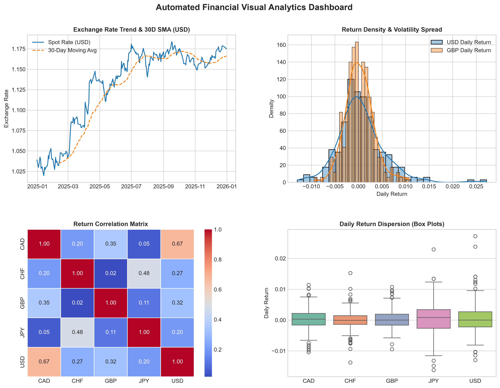

# Automated Foreign Exchange (Forex) Analysis Report
**Generated by:** Codomax Financial Data Pipeline  
**Dataset Time Window:** 2024-12-31 to 2025-12-31  
**Trading Observations Analyzed:** 256 business days  

---

## 1. Executive Summary
- **Tracked Assets:** CAD, CHF, GBP, JPY, USD against base currency (EUR).
- **Strongest Performing Asset:** **USD** with a net change of **13.1%**.
- **Weakest Performing Asset:** **CHF** with a net change of **-1.04%**.
- **Highest Volatility Asset:** **JPY** with an annualized volatility of **8.05%**.

---

## 2. Statistical Performance Summary
The following metrics were calculated using Pandas and vectorized NumPy routines:

|     |   Initial Rate |   Final Rate |   Total Return (%) |   Daily Mean Return (%) |   Annualized Volatility (%) |   Max Spot |   Min Spot |
|:----|---------------:|-------------:|-------------------:|------------------------:|----------------------------:|-----------:|-----------:|
| CAD |         1.4948 |       1.6088 |               7.63 |                  0.0294 |                        5.5  |     1.6393 |     1.4699 |
| CHF |         0.9412 |       0.9314 |              -1.04 |                 -0.0037 |                        4.67 |     0.9641 |     0.9185 |
| GBP |         0.8292 |       0.8726 |               5.24 |                  0.0205 |                        4.72 |     0.8846 |     0.8253 |
| JPY |       163.06   |     184.09   |              12.9  |                  0.0489 |                        8.05 |   184.77   |   156.5    |
| USD |         1.0389 |       1.175  |              13.1  |                  0.0495 |                        7.88 |     1.1837 |     1.0198 |

---

## 3. Pairwise Return Correlation Matrix
Correlation coefficients reflecting how asset price movements co-vary:

|     |   CAD |   CHF |   GBP |   JPY |   USD |
|:----|------:|------:|------:|------:|------:|
| CAD | 1     | 0.204 | 0.355 | 0.054 | 0.673 |
| CHF | 0.204 | 1     | 0.019 | 0.477 | 0.266 |
| GBP | 0.355 | 0.019 | 1     | 0.113 | 0.324 |
| JPY | 0.054 | 0.477 | 0.113 | 1     | 0.202 |
| USD | 0.673 | 0.266 | 0.324 | 0.202 | 1     |

---

## 4. Visual Analytics Dashboard
Below is the auto-generated analytical figure displaying exchange rate moving averages, return densities, correlation heatmaps, and outlier dispersions:

---

*Report automatically generated by Python Data & APIs Analysis Pipeline.*
